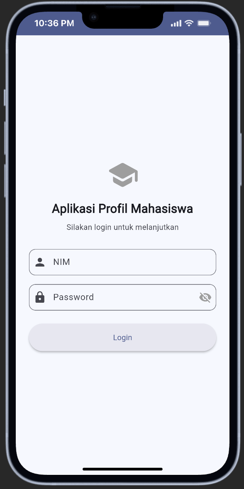
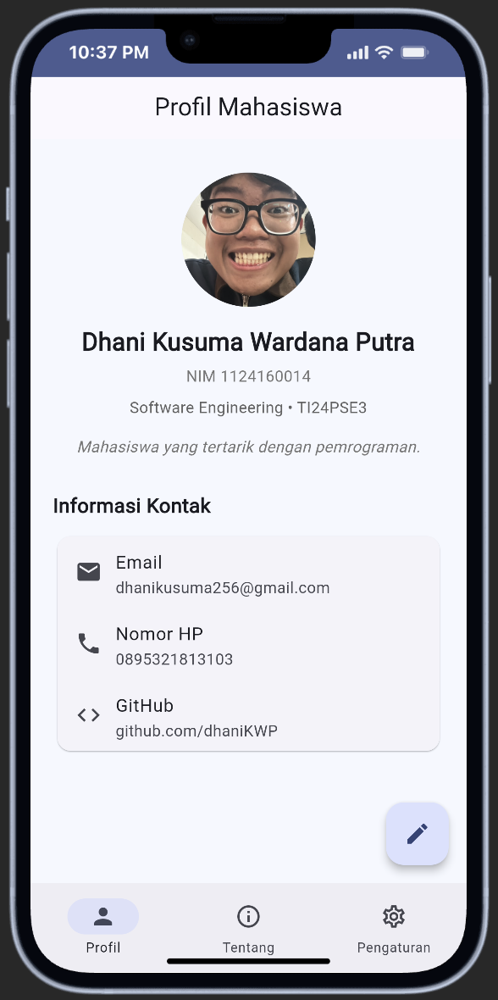
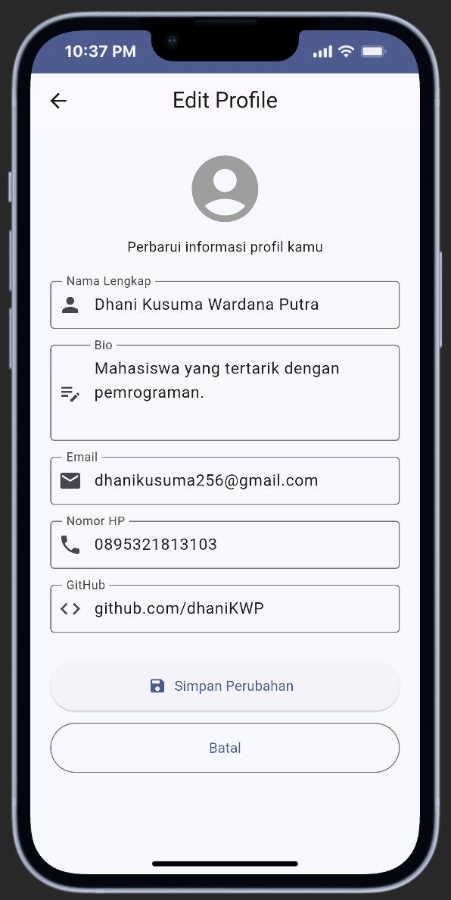
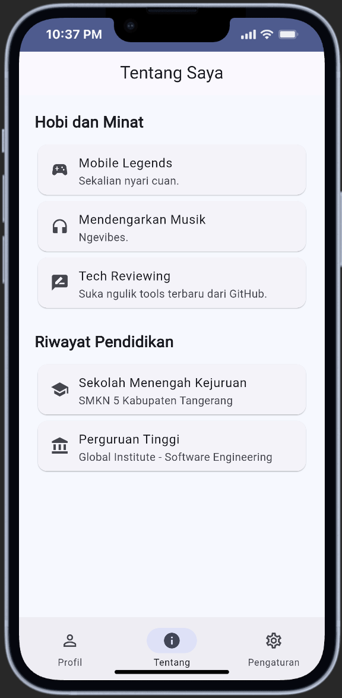
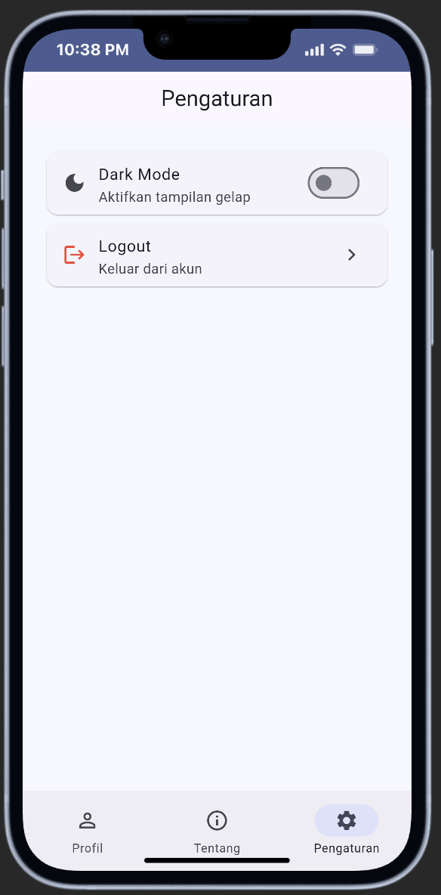

# Aplikasi Profil Mahasiswa

Aplikasi Android berbasis Flutter yang menampilkan informasi profil mahasiswa. Project ini dibuat untuk memenuhi tugas UTS Mobile Programming.

## Identitas

- **Nama:** Dhani Kusuma Wardana Putra
- **NIM:** 1124160014
- **Program Studi:** Software Engineering
- **Kelas:** TI24PSE3
- **GitHub:** [@dhaniKWP](https://github.com/dhaniKWP)

## Video Presentasi

blum di buat

## Screenshot Aplikasi

<table>
  <tr>
    <td align="center">
      <b>Login</b><br>
      
    </td>
    <td align="center">
      <b>Profil Mahasiswa</b><br>
      
    </td>
    <td align="center">
      <b>Edit Profil</b><br>
      
    </td>
  </tr>
  <tr>
    <td align="center">
      <b>Tentang Saya</b><br>
      
    </td>
    <td align="center">
      <b>Pengaturan</b><br>
      
    </td>
  </tr>
</table>

## Fitur Aplikasi

- **Login:** Masuk menggunakan NIM dan password dengan validasi form.
- **Profil Mahasiswa:** Menampilkan foto, identitas, dan informasi kontak.
- **Edit Profil:** Mengubah data profil dengan validasi.
- **Tentang Saya:** Menampilkan hobi, keahlian, dan riwayat pendidikan.
- **Navigasi:** Berpindah halaman Profil, Tentang Saya, dan Pengaturan.
- **Dark Mode:** Mengubah tampilan aplikasi menjadi mode terang atau gelap.
- **Floating Action Button:** Tombol untuk membuka halaman Edit Profil.

## Struktur Kode

```text
lib/
├── main.dart
├── models/
│   └── profile.dart
├── screens/
│   ├── login_page.dart
│   ├── profile_page.dart
│   ├── edit_profile_page.dart
│   └── about_page.dart
└── widgets/
    └── info_tile.dart
```

## Akun Demo

- **NIM:** `1124160014`
- **Password:** `global`

## Cara Menjalankan

### Prasyarat
- Flutter SDK
- Android Studio
- Emulator Android atau HP Android

### Instalasi

Clone repository:

```bash
git clone https://github.com/dhaniKWP/soal2-uts-pml-1124160014.git
```

Masuk ke folder proyek:

```bash
cd soal2_profile_app
```

Install dependencies:

```bash
flutter pub get
```

Jalankan aplikasi:

```bash
flutter run
```

## Build APK

Untuk membuat APK Release:

```bash
flutter build apk --release
```

File APK berada di:

```text
build/app/outputs/flutter-apk/app-release.apk
```

## Download APK

APK Release dapat diunduh melalui GitHub Releases:

[Download APK Profil Dhani](https://github.com/dhaniKWP/soal2-uts-pml-1124160014/releases)

## Teknologi yang Digunakan

- Flutter
- Dart
- Material Design 3
- Android Studio
